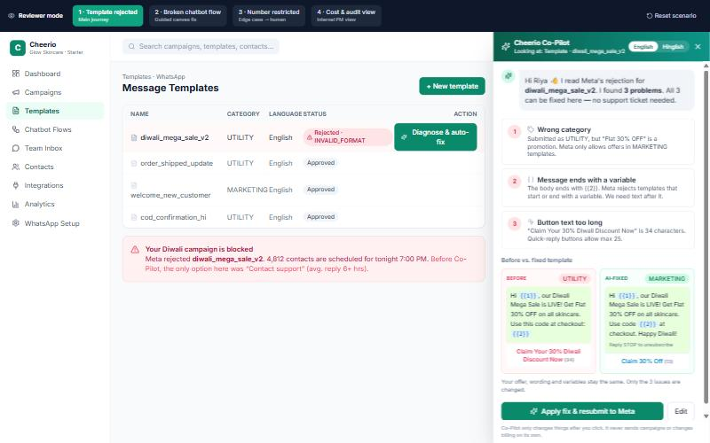
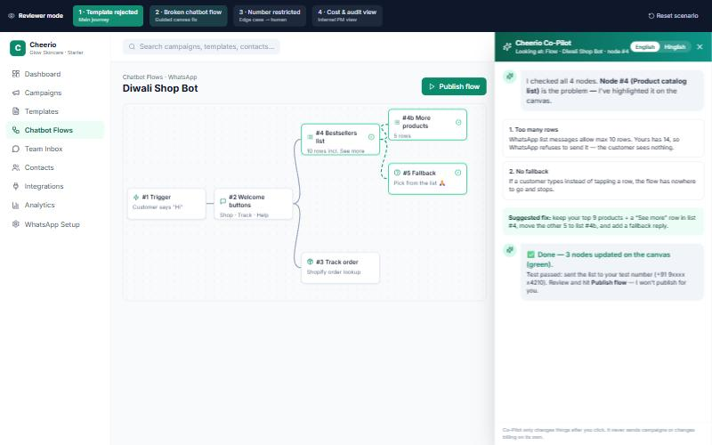
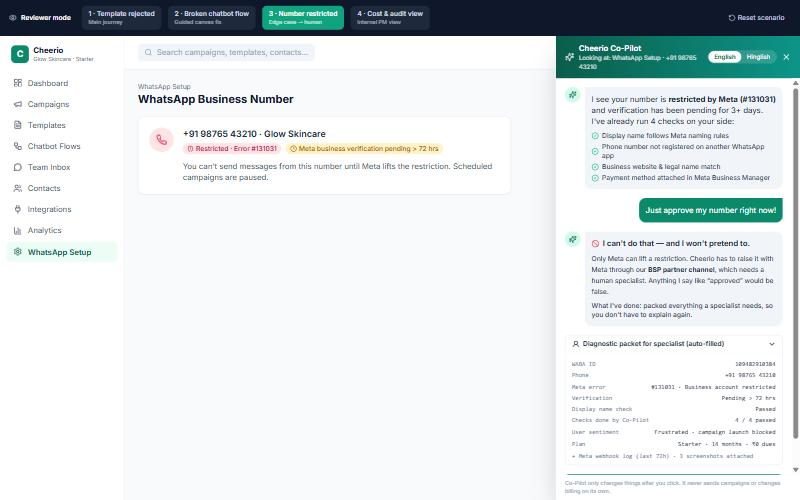
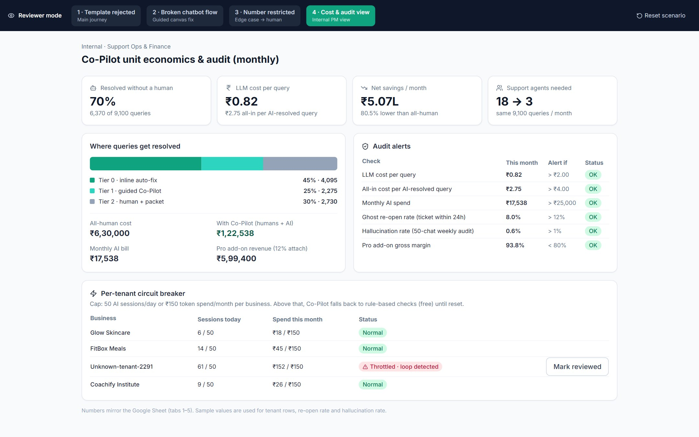

# Cheerio Co-Pilot: support that fixes the problem, not just explains it

**Assignment A — Make customer support scale for non-technical users** · Nipun Goel · Oct 2026
**Live Design Prototype:** [prototype-lilac-ten.vercel.app](https://prototype-lilac-ten.vercel.app) · **Cost, Billing & Audit Google Sheet:** [open sheet](https://docs.google.com/spreadsheets/d/1ygh9ABgRHeCHKGz5Qe62OcML2P5Nz-_vOVG9SVSdc9w/edit?usp=sharing) · **GitHub Repository:** [nipungoel24/cheerio-ai-support-copilot](https://github.com/nipungoel24/cheerio-ai-support-copilot)

---

## Part 1: Solution

### 1. Who is the user, and which 5 queries come first?

**User: "Riya", a D2C founder or marketing manager at a 2–20 person business** (skincare brand, hotel, coaching institute). She runs WhatsApp campaigns herself, has no developer, and knows her business well but not Meta's rules. Her goal is to get today's campaign out. She gets stuck because Meta's rules stay invisible until something is rejected, and the error she sees (`INVALID_FORMAT`, `#131031`) means nothing to her.

| # | Query (share of tickets*) | Why she gets stuck | Why solve it first |
|---|---|---|---|
| 1 | **Template rejected by Meta** (28%) | Category rules, variable placement and 25-char button limits aren't shown up front | Highest volume; rejection reasons come back from Meta in a format we can read and fix in code |
| 2 | **Chatbot flow node not working** (22%) | List limits (10 rows), missing fallbacks, dead ends are silent | Our own canvas, so we can lint and auto-repair nodes |
| 3 | **WABA onboarding / number verification stuck** (18%) | Meta Business Manager steps are confusing; status is unclear | Most onboarding steps can be checked automatically. A human is needed only when Meta itself is blocking |
| 4 | **Campaign delivery drops** (17%) | 24-hour window, tier limits, quality rating are invisible | Delivery logs plus the tier and window rules are enough to explain most drops |
| 5 | **Shopify / Zoho / webhook sync** (10%) | Auth expiry, field mapping | Native integrations can be test-pinged and re-authed in one click |

*Assumed mix. Validate against helpdesk tags in week 1. Together these are **95% of volume**. Billing disputes and bans (5%) stay human. Ranked by **volume × how fixable in-product**: each one has an error signal we can read in code, so it can be fixed where the user already is.

### 2. Possible solutions and why I picked one

| Option | What it is | Impact | Effort | Verdict |
|---|---|---|---|---|
| A. Help centre + video academy | Static docs, walkthroughs | Low | Low | Users read it, still can't fix `{{2}}` syntax |
| B. FAQ chatbot (Intercom-style RAG) | Q&A over docs, bottom-right bubble | Medium | Low | User must describe a technical error they don't understand |
| C. Pre-flight validators (no AI) | Rule checks before submit | Medium | Low | Great base layer, but can't explain or rewrite |
| D. Human concierge onboarding | CSM sets up every new account | High | High | Grows linearly with users: the exact problem we're solving |
| E. Community / WhatsApp support group | Peer help | Low | Low | Slow, inconsistent, not for urgent blockers |
| F. Autonomous agent in Meta Business Suite | AI clicks around Meta on user's behalf | High | Very high | Brittle, risky with account permissions, Meta ToS concerns |
| **G. Cheerio Co-Pilot (chosen)** | **In-context diagnosis + 1-click fix + smart human handoff** | **High** | **Medium** | **Closes the "execution gap"** |

**Why G:** Non-technical users don't lack *information*, they lack the ability to *apply* it. A chatbot (B) can tell Riya "variables can't end a template", but she still has to find and edit it herself. Co-Pilot already **knows the screen, the error and the account**, so it can show the fix and apply it with one click. It also includes C as its first layer: deterministic rules run first (cheap, never hallucinate), and the LLM is used only to explain and to rewrite.

### 3. The solution: what it will and won't do

Co-Pilot is a context-aware assistant built into the Cheerio dashboard. It works in 3 tiers:

- **Tier 0: inline auto-fix (target 45% of queries).** When an error appears (template rejected, flow node broken), a "Diagnose & auto-fix" button shows up right next to it, *before* the user thinks of raising a ticket.
- **Tier 1: guided Co-Pilot drawer (25%).** For multi-step problems (WABA setup, delivery drops), it walks the user through the steps, runs checks itself and explains in English or Hinglish.
- **Tier 2: human with a diagnostic packet (30%).** When AI shouldn't or can't fix it, it creates the ticket with IDs, logs and steps already tried. The user types nothing.

| It WILL | It will NOT |
|---|---|
| Read the page state + Meta/API error payload | Send or schedule a campaign without the user's click |
| Explain the cause in plain English / Hinglish | Change plan, billing or credits |
| Propose a before/after fix and apply it on confirm | Claim Meta approved / unbanned something it can't verify |
| Pre-check against Meta rules before resubmitting | Guess when confidence < 0.78. It escalates instead |
| Package logs + context when escalating | Touch the user's Meta Business Manager directly |

### 4. When does a human still step in?

1. **Meta-side blocks:** account restrictions (`#131031`), green-tick appeals, stuck number migrations. Only Meta can fix these, through Cheerio's BSP partner channel.
2. **Money:** billing disputes, refunds, credit adjustments, enterprise contract changes.
3. **Custom tech:** custom ERP or webhook payloads outside our native integrations.
4. **Loop or frustration:** 2 failed AI fixes in a row, the user asks for a human, or negative sentiment is detected. The user can always reach a human with one click.

### 5. How I'll measure success (3 metrics)

| Metric | Definition | Target (month 3) |
|---|---|---|
| **True self-serve resolution rate** | % of Co-Pilot sessions where the blocked action completes in 15 min **and** no human ticket in next 48 h | ≥ 65% |
| **Escalated-ticket handling time** | Avg. agent minutes per escalated ticket (packet removes back-and-forth) | 18 → 10 min |
| **24-hour activation** | % of new workspaces that send their first approved WhatsApp campaign within 24 h of signup | +15 pts vs. baseline |

*Guardrail:* "ghost re-open" rate (AI said solved, but a ticket was raised within 24 h) must stay **< 12%**, so we never hit a target by hiding tickets.

### 6. North Star metric

**Self-Serve Setup Resolution Rate (SSSRR):** % of users who hit a setup error or support intent and **finish the blocked task** (template approved, flow published, integration live) **within 30 minutes, with no human**.

It captures the real value: Riya's campaign goes out *and* Cheerio needs no extra hire. Deflection alone can be gamed by hiding the support button. SSSRR only counts a query when the user's blocked task actually got done.

**Target: from ~18% today (est., passive docs; measure in week 1) to 65% in 12 weeks.**

| Month | Ship | SSSRR target |
|---|---|---|
| 1 | Template auto-fixer + Meta pre-flight checker (the 28% bucket) | 38% |
| 2 | Flow-canvas linter + auto-repair, WABA onboarding diagnostic wizard | 52% |
| 3 | Hinglish, Shopify/Zoho test-ping + re-auth, weekly fixes from re-open audit | 65% |

How I'll get there: ship by volume bucket, instrument every session (diagnosis shown → fix applied → task completed → ticket in 48 h?), and every week turn the top 3 escalation reasons into new deterministic fixes.

---

## Part 2: Prototype

**Link:** [prototype-lilac-ten.vercel.app](https://prototype-lilac-ten.vercel.app) · Built with React + Tailwind. A **Reviewer mode** bar at the top switches between scenarios.

| Scenario | What it shows |
|---|---|
| **1. Template rejected (main journey, end to end)** | Riya's Diwali template is rejected → "Diagnose & auto-fix" → 3 root causes (category, trailing variable, 34-char button) → before/after preview → apply → live pre-check → Approved → 👍/👎 feedback. 👎 opens a ticket with full context. English/Hinglish toggle. |
| **2. Broken chatbot flow** | Co-Pilot highlights the broken node (14-row list, no fallback) on the canvas → one click splits the list and adds a fallback → user publishes (Co-Pilot doesn't). |
| **3. Edge case: number restricted by Meta** | User demands "Just approve my number!" → Co-Pilot refuses to fake it, explains why → shows auto-filled diagnostic packet → escalates as ticket #CH-8842 with zero typing. |
| **4. Internal cost & audit view** | Deflection funnel, cost per query, savings, alert status, per-tenant circuit breaker. |

---

## Part 3: How I used AI

**1. Tools and what for**

| Tool | What I used it for |
|---|---|
| **Gemini** | Brainstorming the core thesis (why an inline diagnose-and-fix agent beats an Intercom-style FAQ bot for non-technical Meta BSP users) and structuring my first requirements prompt |
| **Claude Code (Opus)** | Building the React + Tailwind prototype, writing `generate_financial_model.py` (openpyxl, live formulas), and auditing my unit economics and Meta API error codes |

**2. Three prompts that worked, one that failed**

- ✅ **Formula-only sheet:** *"Never hardcode calculated outputs. Every derived number MUST use an Excel formula string (e.g. =B6\*B7) so formulas are 100% visible in Google Sheets. Colour assumption cells blue."* This gave me a sheet a reviewer can audit, not a table of pasted numbers.
- ✅ **Scenario state machine:** *"Clicking opens the Co-Pilot drawer with an English / Hinglish toggle → 3-point root cause → before vs. AI-fixed preview → Apply & resubmit → animated validation → Approved → 'Did this solve your issue? 👍 / 👎 Need human'."* Spelling out every state got me a real end-to-end flow on the first try, not a static mock.
- ✅ **Refusal + handoff:** *"User asks 'Just approve my number right now!' Explicitly show what the AI will NOT do: refuse to fake Meta verification for #131031, then show an auto-compiled diagnostic packet and escalate."* This produced Scenario 3, the edge case I care most about.
- ❌ **Failed:** my first master prompt gave the AI both the inputs (160 productive hours, 10-min handling time, token prices) *and* my back-of-the-envelope targets (800 tickets/agent, 4 agents, ₹0.65–1.10 per query). By over-constraining it, I made the narrative fight the actual maths. **What I changed:** I told Claude Code to treat the spreadsheet formulas as the single source of truth and to overwrite every number in the doc and prototype with the formula outputs.

**3. Where AI gave a wrong or weak answer, and how I caught it**

- **Agent capacity (960 vs. 800):** the first draft said a 10-min handling time over 160 hours meant 800 tickets/agent, so 4 agents. Auditing the formula (160 × 60 / 10 = **960**) showed **3 agents** cover the 2,730 escalated tickets, which lifts savings to **₹5.07L/month (80.5%)**.
- **Raw token cost vs. real unit cost:** looking only at LLM spend (**₹0.82/query**) hid the $120/month infra and the tokens spent on the 30% of queries that escalate anyway. Dividing total AI spend by the 6,370 AI-resolved queries gives the honest number: **₹2.75 per resolved query**.
- **Meta error code:** the draft used `#131009` for a rejected template. In Meta's API that is a send-time "parameter value not valid" error. Template rejections come back as a rejection reason such as `INVALID_FORMAT` or `INCORRECT_CATEGORY`, so I changed the prototype to show that.

**4. What I did myself, without AI**

- Picked Assignment A, because for a Meta BSP serving non-technical Indian SMBs, setup friction (templates, WABA verification, flow rules) is the real scaling bottleneck.
- Decided core setup diagnostics + 15 auto-fixes/month must be **free**. Charging people while they're stuck onboarding drives churn and sends them back to tickets. Power users pay through the **₹999/month Pro add-on (93.8% margin)**.
- Drew the human-escalation boundaries (`#131031` account restrictions, billing disputes, 2 failed fixes in a row), and checked every spreadsheet formula and every prototype state myself.

---

## Part 4: Numbers (summary; every value is a live formula in the Google Sheet)

**1. Guesstimate**: 5,000 businesses: 750 onboarding × 4.2 queries + 4,250 existing × 1.4 = **9,100 queries/month**. Co-Pilot resolves **6,370 (70%)**: 45% inline auto-fix + 25% guided. **2,730** still reach a human.

**2. Running cost (per query, multi-turn)**

| Item | Value |
|---|---|
| Tokens per query | 3.5 turns × 2,800 in = 9,800 input · 3.5 × 450 = 1,575 output |
| Models (Anthropic pricing, Oct 2026) | 80% Claude Haiku 5.5 ($0.10 / $0.50 per 1M) · 20% Claude Sonnet 5.5 ($2 / $10 per 1M) |
| LLM cost per query (+15% retry buffer, ₹84/$) | **₹0.82** (100% Sonnet worst case: ₹3.41) |
| Fixed infra (vector DB, Langfuse, hosting) | $120/month |
| **Monthly AI cost** | **₹17,538** · ₹1.93 per query · **₹2.75 per AI-resolved query** |

**3. Billing: free core + paid Pro add-on**

| Option | Verdict |
|---|---|
| Per-conversation (₹5/query) | ❌ Charges users exactly when they're stuck → they go back to tickets |
| Credits pool | ❌ Non-technical owners shouldn't budget for "help" |
| Free for all | ✅ for setup fixes (15 free auto-fixes/month, covers ~3× typical need) |
| **Plan add-on: Co-Pilot Pro ₹999/month** | ✅ Unlimited template rewriter, auto-flow builder, priority audit. Free in Growth/Enterprise |

At 12% attach (600 businesses): **₹5,99,400/month revenue** vs. ₹17,538 AI cost + ₹19,670 extra Pro usage → **93.8% gross margin**. Break-even is **38 buyers**. Even at 0 buyers, AI costs **₹3.51 per business per month**, which the support savings below pay for many times over.

**4. Monthly audit and alerts**

| Check | Alert when | Action |
|---|---|---|
| LLM cost per query | > ₹2.00 (≈2.4× plan) | Check router share and prompt size; roll back last prompt change |
| All-in cost per AI-resolved query | > ₹4.00 | Cut turns or add deterministic fixes for low-resolution intents |
| Per-tenant cap | > 50 sessions/day or ₹150/month | Auto-throttle to free rule-based checks; notify CSM |
| Ghost re-open rate | > 12% | Fix prompts/playbooks for top re-opened intents |
| Hallucination (50 chats/week, LLM judge + PM spot-check) | > 1% | Pull intent from auto-fix; add doc to RAG; re-test |
| Pro margin / billing reconciliation | < 80% / gap > 0.5% | Revisit free cap or price; fix entitlement sync |

Monthly ritual: reconcile the Anthropic invoice against our token logs (gap > 2% → investigate), review every ALERT with an owner, and check the top 10 tenants by spend (a free tenant in the top 10 → review the fair-use cap).

**5. Savings vs. all-human support (same 9,100 queries)**

| | All human | With Co-Pilot |
|---|---|---|
| Tickets to humans | 9,100 | 2,730 |
| Handling time | 18 min (533/agent/mo) | 10 min with packet (960/agent/mo) |
| Agents (₹35,000 loaded) | 18 → ₹6,30,000 | 3 → ₹1,05,000 |
| AI cost | – | ₹17,538 |
| **Total / month** | **₹6,30,000** | **₹1,22,538** |

**Savings: ₹5,07,462/month (₹60.9 L/year, −80.5%).** The bigger point is scaling: if customers double, all-human needs **35 agents**; with Co-Pilot it needs **6**.
